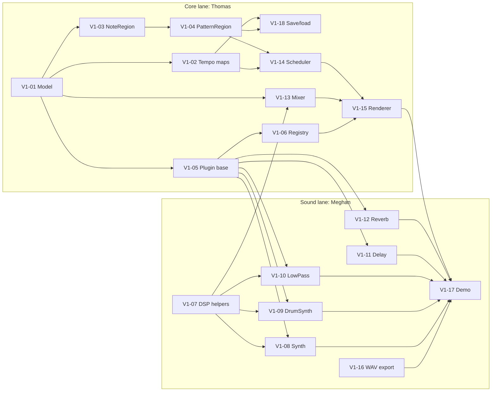

# Beats Per Matrix — Project Plan

A music production app modeled on Logic Pro, written in plain MATLAB `.m` files.
This document is the design that Meghan (product owner) and Thomas (architecture reviewer) approve
before features are built. It changes only through pull requests.

**Working on a task?** The to-do list is the
[v1 task board](#v1-task-board-who-does-what-in-what-order) in section 8: two lanes,
one per person, so you can work in parallel.

- **Minimum MATLAB:** R2025a. CI tests against R2025a.
- **Toolboxes:** none required. Base MATLAB first; optional toolbox features are isolated and flagged
  (see [Toolbox strategy](#6-toolbox-strategy)).
- **Test command:** `matlab -batch "runtests('tests')"`, run from the repository root.

---

## 1. Architecture

Four layers. Each layer only calls the layer below it.

```
┌──────────────────────────────────────────────────────────────┐
│ UI (bpm.ui, v2)  uifigure views: arrangement, piano roll,    │
│                  step grid, mixer. Talk ONLY to Session.     │
├──────────────────────────────────────────────────────────────┤
│ Session (bpm.ui.Session, v2)  current Project + undo/redo     │
│                  stack + render/play commands                │
├──────────────────────────────────────────────────────────────┤
│ Engine (bpm.engine)  Project -> audio. Block-based renderer,  │
│                  event scheduler, mixer.                     │
├──────────────────────────────────────────────────────────────┤
│ Plugins (bpm.plugins / bpm.instruments / bpm.effects)         │
│                  stateful DSP objects, common interface      │
├──────────────────────────────────────────────────────────────┤
│ DSP helpers (bpm.dsp)  small pure functions (ADSR, biquad...) │
├──────────────────────────────────────────────────────────────┤
│ Model (bpm.model)  pure data, no audio state, JSON-friendly   │
└──────────────────────────────────────────────────────────────┘
```

### Render flow (offline, v1)

```
for each block of BlockSize frames (default 1024):
    for each track (respecting mute/solo):
        events = EventScheduler.eventsInBlock(track, blockStartBeat, blockEndBeat)
        y = track.instrumentObj.process(events, numFrames)          % numFrames x 2
        for each effect in track chain:  y = effectObj.process(y)
        y = Mixer.applyGainPan(y, track.volumeDb, track.pan)
        masterBus = masterBus + y
    for each master effect:  masterBus = effectObj.process(masterBus)
    append masterBus to output
render the "tail" (reverb/delay ring-out) until silence or a max tail length
```

---

## 2. Folder structure

```
+bpm/                      MATLAB namespace (package): everything is bpm.<area>.<name>
  +model/                  Project, Track, Region (abstract), NoteRegion, PatternRegion,
                           AudioRegion (stretch), TempoMap, TimeSignatureMap,
                           AutomationLane, PluginSpec
  +plugins/                Plugin (abstract), Instrument (abstract), Effect (abstract),
                           ParamInfo, registry(), create()
  +instruments/            Synth, DrumSynth (v1); Sampler, DrumKit (v2)
  +effects/                LowPass, Delay, Reverb (v1); EQ, Compressor (v2);
                           Chorus, Distortion, ... (stretch)
  +dsp/                    adsr, polyblepOsc, biquadCoeffs, dbToGain, panGains
  +engine/                 render(), Mixer, EventScheduler
  +io/                     exportWav, saveProject, loadProject (JSON);
                           readMidi, writeMidi (v2)
  +ui/                     (v2) App, Session, ArrangementView, PianoRollView, StepGridView
  +util/                   hasToolbox and other small helpers
  +realtime/               (stretch, Audio Toolbox) live playback / recording / MIDI input
tests/                     matlab.unittest test classes. FLAT folder (see Testing)
examples/                  demo scripts, e.g. demo_v1.m renders a short song to WAV
.github/workflows/ci.yml   CI: tests + Discord summary
.claude/                   Claude Code project settings and hooks
PLAN.md  CLAUDE.md  AGENTS.md  LESSONS.md
```

Why a `+bpm` namespace: MATLAB has one global function namespace. Without a package, our `render`
or `Delay` could collide with user functions or toolbox functions. Package folders give us
`bpm.engine.render` with no path tricks, because the repo root is the only folder that needs to be on the path.

---

## 3. Key design decisions

Each decision lists what we chose, why, and what we rejected.

| # | Decision | Why | Rejected alternatives |
|---|---|---|---|
| D1 | **Model = value classes; plugins and engine = handle classes** | Value semantics make undo/redo, snapshots, and tests simple: `p2 = p.addTrack(t)` never changes `p`. Plugins carry DSP state (filter memory, delay lines), which is what handle objects are for. | *All handle classes:* aliasing bugs (two tracks sharing one object) and undo needs deep copies. *Plain structs:* no validation, no methods, typos create silent new fields. |
| D2 | **The model stores plugin *specs*, not plugin objects** | A `PluginSpec` is just `type` + `params` + `bypass`. The engine creates the live object at render time. Projects stay JSON-serializable, and saved files don't depend on private class internals. | *Store plugin objects in the model:* can't JSON-encode them, and saved projects break when a class changes. |
| D3 | **Musical time (beats) everywhere in the model** | Notes, regions and automation are in beats (quarter notes). Only the engine converts beats → seconds → samples, through `TempoMap`. Changing tempo then "just works". | *Seconds or samples in the model:* every tempo change would rewrite every note. |
| D4 | **Tempo and time signature are *maps* from day one** | v1 enforces exactly one entry, but the file format already supports changes, so the stretch feature needs no format migration. | *Single `tempo` number:* simpler today, format break later. |
| D5 | **Block-based plugin interface (like VST/AU)** | `process(events, numFrames)` per block is what automation, freezing, and any future real-time path need. | *Whole-buffer vectorized render* (`render(allNotes)`): faster to write and faster in MATLAB, but forces a rewrite of every instrument for automation or real-time. |
| D6 | **Plugin discovery by package introspection** | `bpm.plugins.registry()` lists concrete subclasses in `bpm.instruments` and `bpm.effects` using `meta.package`. Adding a plugin means adding one class file. | *Hand-maintained registry list:* easy to forget, causes merge conflicts. |
| D7 | **Parameters described by `ParamInfo`** | Each plugin declares name, default, range, unit and scale. The GUI can auto-build knobs, automation can target parameters by name, and validation is shared. | *Free-form properties:* every GUI panel and every automation target hand-coded. |
| D8 | **Projects saved as JSON** (`jsonencode`/`jsondecode`) | Human-readable, diffs in Git, base MATLAB, versioned with `formatVersion`. | *`.mat` files:* binary, no diffs, tied to class definitions. |
| D9 | **Stereo everywhere** (`numFrames x 2`) | One buffer shape through the whole engine; mono instruments just write both channels. | *Mono until the mixer:* saves memory but every effect needs two code paths later (stereo reverb, ping-pong delay). |
| D10 | **Hand-written DSP in the core** | Portable to base MATLAB, and the algorithms stay visible and testable. | *Toolbox functions* (`designfilt`, `reverberator`): shorter, but excludes users without toolboxes. |

---

## 4. Data model and file format

All classes live in `bpm.model` and are **value classes** with validated properties.
Time values are in **beats** (1 beat = 1 quarter note) unless the name says otherwise.

### Classes

```
Project
  formatVersion   double   (1)
  name            string
  sampleRate      double   (44100; one of 44100, 48000, 96000)
  lengthBeats     double   (song length; render end if not given)
  tempoMap        TempoMap
  timeSigMap      TimeSignatureMap
  tracks          Track[]                 (track order = mixer order)
  masterEffects   PluginSpec[]
  masterVolumeDb  double   (0)

TempoMap          rows of (beat, bpm). v1: exactly one row at beat 0.
  beatsToSeconds(beats) / secondsToBeats(sec) / beatsToSamples(beats, fs)

TimeSignatureMap  rows of (bar, numerator, denominator). v1: one row at bar 1.
  barToBeat(bar) / beatToBarBeat(beat)

Track
  id              string   (stable unique id, e.g. "trk-0001")
  name            string
  instrument      PluginSpec
  effects         PluginSpec[]
  volumeDb        double   (0; range -inf..+6)
  pan             double   (0; range -1 left .. +1 right)
  mute, solo      logical
  regions         Region[]                (heterogeneous array; see note below)
  automation      AutomationLane[]

Region (abstract, matlab.mixin.Heterogeneous)
  startBeat, lengthBeats, name

NoteRegion < Region
  notes           table with variables
                    Start     beats, relative to region start (>= 0)
                    Duration  beats (> 0)
                    Pitch     MIDI note number 0–127 (60 = middle C)
                    Velocity  MIDI velocity 1–127

PatternRegion < Region          (the 16-step drum sequencer)
  numSteps        16
  stepBeats       0.25           (16th notes)
  lanes           struct array: name, pitch (GM drum note), on (1 x numSteps logical),
                  velocity (1 x numSteps, 1–127)
  toNoteRegion()  -> NoteRegion  (the engine only ever plays notes)

AudioRegion < Region            (stretch: recorded or imported audio)
  file, offsetSeconds, gainDb

AutomationLane
  target          string  "volumeDb" | "pan" | "instrument.<param>" | "effects(<k>).<param>"
  points          N x 2 [beat value], sorted by beat
  interp          "linear" | "step"

PluginSpec
  type            string  fully qualified class, e.g. "bpm.effects.Delay"
  params          struct  parameter name -> value (missing = default)
  bypass          logical
```

Note for Thomas: MATLAB arrays must be one class. `matlab.mixin.Heterogeneous` lets one
`Region[]` array hold `NoteRegion` and `PatternRegion` objects. This is MATLAB's standard
mechanism, but it has rules worth reviewing (sealed methods, default object).

### File format (JSON example)

```json
{
  "formatVersion": 1,
  "name": "Demo",
  "sampleRate": 44100,
  "lengthBeats": 16,
  "tempoMap": [{"beat": 0, "bpm": 120}],
  "timeSigMap": [{"bar": 1, "numerator": 4, "denominator": 4}],
  "masterVolumeDb": 0,
  "masterEffects": [{"type": "bpm.effects.Reverb", "params": {"mix": 0.2}, "bypass": false}],
  "tracks": [
    {
      "id": "trk-0001", "name": "Lead", "volumeDb": -3, "pan": 0.2, "mute": false, "solo": false,
      "instrument": {"type": "bpm.instruments.Synth",
                     "params": {"waveform": "saw", "attack": 0.01, "release": 0.3}, "bypass": false},
      "effects": [{"type": "bpm.effects.LowPass", "params": {"cutoffHz": 1800, "q": 0.7}, "bypass": false}],
      "regions": [
        {"kind": "note", "name": "Riff", "startBeat": 0, "lengthBeats": 4,
         "notes": [{"start": 0, "duration": 1, "pitch": 60, "velocity": 100},
                   {"start": 1, "duration": 0.5, "pitch": 64, "velocity": 90}]}
      ],
      "automation": [{"target": "effects(1).cutoffHz", "points": [[0, 400], [4, 4000]], "interp": "linear"}]
    },
    {
      "id": "trk-0002", "name": "Drums", "volumeDb": 0, "pan": 0, "mute": false, "solo": false,
      "instrument": {"type": "bpm.instruments.DrumSynth", "params": {}, "bypass": false},
      "effects": [],
      "regions": [
        {"kind": "pattern", "name": "Beat A", "startBeat": 0, "lengthBeats": 4,
         "numSteps": 16, "stepBeats": 0.25,
         "lanes": [{"name": "Kick",  "pitch": 36, "on": [1,0,0,0,1,0,0,0,1,0,0,0,1,0,0,0], "velocity": [110,0,0,0,110,0,0,0,110,0,0,0,110,0,0,0]},
                   {"name": "Snare", "pitch": 38, "on": [0,0,0,0,1,0,0,0,0,0,0,0,1,0,0,0], "velocity": [0,0,0,0,100,0,0,0,0,0,0,0,100,0,0,0]}]}
      ],
      "automation": []
    }
  ]
}
```

`loadProject` checks `formatVersion` and runs migrations when the format changes.

---

## 5. Main signatures

```matlab
%% Plugins (bpm.plugins) — handle classes
classdef (Abstract) Plugin < handle
    methods (Abstract)
        prepare(obj, sampleRate, maxBlockSize)   % allocate buffers, compute coefficients
        reset(obj)                               % clear state (filter memory, voices)
    end
    methods
        info = parameters(obj)                   % -> bpm.plugins.ParamInfo array
        setParameter(obj, name, value)           % validated against ParamInfo
        value = getParameter(obj, name)
        spec = toSpec(obj)                       % -> bpm.model.PluginSpec
    end
end

classdef (Abstract) Instrument < bpm.plugins.Plugin
    methods (Abstract)
        y = process(obj, events, numFrames)
        % events: table(Frame, Type, Pitch, Velocity), Frame = 1..numFrames within this block,
        %         Type = "on" | "off". y: numFrames x 2 double.
    end
end

classdef (Abstract) Effect < bpm.plugins.Plugin
    methods (Abstract)
        y = process(obj, x)          % x, y: numFrames x 2 double
    end
    methods
        n = tailFrames(obj)          % how long the effect rings after input stops (default 0)
    end
end

classdef ParamInfo                   % value class
    % Name, Default, Min, Max, Unit ("Hz","s","dB",""), Scale ("linear"|"log"|"choice"),
    % Choices (for "choice"), Description
end

list = bpm.plugins.registry()        % table(Type, Kind, DisplayName)
obj  = bpm.plugins.create(spec)      % PluginSpec -> configured plugin object

%% Engine (bpm.engine)
[audio, fs] = bpm.engine.render(project, BlockSize=1024, StartBeat=0, EndBeat=[], ...
                                IncludeTail=true)
y = bpm.engine.Mixer.applyGainPan(x, volumeDb, pan)        % constant-power pan law
events = bpm.engine.EventScheduler.eventsInBlock(track, tempoMap, fs, firstFrame, numFrames)

%% IO (bpm.io)
bpm.io.exportWav(audio, fs, filename, BitDepth=24, Normalize=false)
bpm.io.saveProject(project, filename)
project = bpm.io.loadProject(filename)

%% Model (bpm.model) — value classes: methods return modified copies
p = bpm.model.Project(Name="Demo", Tempo=120, SampleRate=44100);
p = p.addTrack(track);   p = p.removeTrack(id);   t = p.track(id);
r = bpm.model.NoteRegion(StartBeat=0, LengthBeats=4);
r = r.addNote(Start=0, Duration=1, Pitch=60, Velocity=100);
sec = p.tempoMap.beatsToSeconds(beats);

%% DSP helpers (bpm.dsp) — pure functions
env = bpm.dsp.adsr(attack, decay, sustain, release, fs, gateFrames, totalFrames)
[b, a] = bpm.dsp.biquadCoeffs(type, f0, q, fs, gainDb)    % RBJ Audio EQ Cookbook
g = bpm.dsp.dbToGain(dB)
[gL, gR] = bpm.dsp.panGains(pan)
```

---

## 6. Toolbox strategy

**Rule:** base MATLAB first. A toolbox is used only where base MATLAB can't reasonably do the job,
and every such use is flagged in the PR.

- **Worth installing (Meghan has these):** **Audio Toolbox**, which changes what's possible: real-time device I/O
  (`audioDeviceWriter`, `audioPlayerRecorder` with ASIO on Windows), `mididevice` for live keyboards,
  and `stretchAudio` for tempo-matching loops. MathWorks lists **Signal Processing Toolbox** and
  **DSP System Toolbox** as its prerequisites, so install all three together. MATLAB Compiler
  (to ship a standalone app) is optional and much later.
- **Isolation:** toolbox-dependent code lives only in clearly named places (`+bpm/+realtime/`,
  `bpm.io.LiveMidiInput`, ...). Each checks `bpm.util.hasToolbox("audio")` and either fails with a
  clear message or falls back to base behavior. The model, engine and v1/v2 plugins never require a toolbox.
- **No toolbox shortcuts in v1/v2,** even once toolboxes are installed (decision D10).
- **Tests:** toolbox-dependent tests call `testCase.assumeTrue(bpm.util.hasToolbox(...))`, so they
  are *skipped* (reported as Incomplete), not failed, on machines without the toolbox.
- **CI runs two variants:** `base` (MATLAB only, which proves the core has no hidden toolbox dependency) and
  `full` (adds Audio, Signal Processing and DSP System toolboxes). Real-time device tests can't run in CI
  (no sound card), so they stay manual.

---

## 7. Testing strategy

- Framework: `matlab.unittest` class-based tests, one test class per unit, named `<Thing>Test.m`.
- **Every test class inherits from `tests/BpmTestCase.m`**, not directly from `matlab.unittest.TestCase`.
  `runtests('tests')` switches the current folder to `tests/` while tests run, which takes the repo root (and
  `+bpm`) off the path. `BpmTestCase` adds the repo root back with a `PathFixture`.
- **The `tests/` folder is flat,** because `runtests('tests')` does not search subfolders.
  Names carry the area instead: `ModelProjectTest.m`, `EffectsDelayTest.m`, `EngineRenderTest.m`.
- Run from the repo root: `matlab -batch "runtests('tests')"`.
- **Audio is tested with numeric checks and tolerances, not golden WAV files** (golden files break across
  platforms and releases). Examples:
  - ADSR reaches peak at `attack*fs` samples and sustain level after decay.
  - LowPass is −3 dB (±0.5 dB) at its cutoff, measured with `fft` on an impulse response.
  - Delay impulse response peaks at exactly `delaySamples`, then at `2*delaySamples` scaled by feedback.
  - Reverb output is finite, and its energy decays block over block.
  - Pan law preserves power (`gL^2 + gR^2 == 1`).
  - Muted tracks render silence; soloing one track silences the others.
  - Rendering in blocks of 64 vs 1024 gives the same result (proves block-state handling is right).
  - DSP tests run at 44100 and 96000 Hz (parameterized), so hard-coded sample-rate assumptions fail.
- Repo hygiene tests: CLAUDE.md and AGENTS.md are identical, and no tracked file contains webhook URLs or token patterns.

---

## 8. Roadmap and task board

Each task is sized to be one GitHub issue and one PR, and ships with tests.

### v1 task board: who does what, in what order

Meghan and Thomas work **in parallel**, each directing their own agent session. v1 is split into
**two lanes** that touch different folders, so the two people's PRs rarely conflict:

- **Sound lane (Meghan):** DSP helpers, instruments, effects, WAV export, demo song.
  Owns `+bpm/+dsp/`, `+bpm/+instruments/`, `+bpm/+effects/`, `+bpm/+io/exportWav.m`, `examples/`.
- **Core lane (Thomas):** data model, plugin framework, mixer, scheduler, renderer, save/load.
  Owns `+bpm/+model/`, `+bpm/+plugins/`, `+bpm/+engine/`, `+bpm/+io/saveProject.m` and `loadProject.m`.

Tests follow the same split: each task's test files belong to its lane.

**How to read the board:** within a lane, do tasks top to bottom. A task can start once everything
under "Needs first" is ✅. Status is ⬜ To do or ✅ Done (with the PR). Work that is in progress shows
up on GitHub as an open (draft) PR that links the issue.

#### Core lane: Thomas

| Order | ID | Task | Issue | Needs first | Status |
|---|---|---|---|---|---|
| 1 | V1-01 | Model skeleton: `Project`, `Track`, `PluginSpec` | #2 | (none) | ✅ Done (PR #20) |
| 2 | V1-05 | Plugin base classes: `Plugin`, `Instrument`, `Effect`, `ParamInfo`. **Unblocks the Sound lane, so do it first.** | #6 | V1-01 | ⬜ To do |
| 3 | V1-02 | `TempoMap` and `TimeSignatureMap` (beat ↔ seconds ↔ samples) | #3 | V1-01 | ⬜ To do |
| 4 | V1-03 | `Region` base + `NoteRegion` | #4 | V1-01 | ⬜ To do |
| 5 | V1-04 | `PatternRegion` (16-step grid) → `toNoteRegion()` | #5 | V1-03 | ⬜ To do |
| 6 | V1-18 | `saveProject` / `loadProject` (JSON round trip) | #19 | V1-01 to V1-04 | ⬜ To do |
| 7 | V1-06 | Plugin `registry()` and `create(spec)` | #7 | V1-05 | ⬜ To do |
| 8 | V1-13 | `Mixer`: volume, constant-power pan, mute/solo, master | #14 | V1-01, **V1-07 (Sound)** | ⬜ To do |
| 9 | V1-14 | `EventScheduler`: notes → per-block events | #15 | V1-02, V1-03, V1-04 | ⬜ To do |
| 10 | V1-15 | `bpm.engine.render`: offline block renderer | #16 | V1-06, V1-13, V1-14 | ⬜ To do |

#### Sound lane: Meghan

| Order | ID | Task | Issue | Needs first | Status |
|---|---|---|---|---|---|
| 1 | V1-07 | DSP helpers: `adsr`, PolyBLEP oscillators, `biquadCoeffs`, `dbToGain`, `panGains`. **Can start now.** | #8 | (none) | ⬜ To do |
| 2 | V1-16 | `bpm.io.exportWav` (16/24-bit, normalize, clipping warning). **Can start now.** | #17 | (none) | ⬜ To do |
| 3 | V1-08 | `Synth` instrument | #9 | **V1-05 (Core)**, V1-07 | ⬜ To do |
| 4 | V1-09 | `DrumSynth` instrument | #10 | **V1-05 (Core)**, V1-07 | ⬜ To do |
| 5 | V1-10 | `LowPass` effect | #11 | **V1-05 (Core)**, V1-07 | ⬜ To do |
| 6 | V1-11 | `Delay` effect | #12 | **V1-05 (Core)** | ⬜ To do |
| 7 | V1-12 | `Reverb` effect | #13 | **V1-05 (Core)** | ⬜ To do |
| 8 | V1-17 | `examples/demo_v1.m` + end-to-end render test | #18 | **V1-15 (Core)**, V1-16, V1-08 to V1-12 | ⬜ To do |

#### Dependencies at a glance



#### Hand-off points between the lanes

These are the only places where one lane waits for the other. Agree on the interface before
building on it.

1. **V1-05 → Sound lane.** The `Plugin` / `Instrument` / `Effect` / `ParamInfo` interface (PLAN.md
   section 5) is what every instrument and effect implements. Thomas does V1-05 first; until it is
   merged, Meghan works on V1-07 and V1-16. Changing that interface later needs both of you to agree.
2. **V1-07 → V1-13.** The Mixer uses Meghan's `bpm.dsp.dbToGain` and `bpm.dsp.panGains`.
   V1-07 is first in the Sound lane, so it should be done before Thomas reaches V1-13.
3. **V1-15 → V1-17.** The demo needs the renderer. V1-15's own tests use a small test-only instrument,
   so the renderer doesn't wait for the real Synth; the real instruments meet the renderer in V1-17.

#### Rules for working in parallel

- **Stay in your lane's folders.** If your task needs a change in the other lane's files, say so in
  your PR or ask the other person, rather than editing their files.
- **One task per branch and PR:** branch `v1-NN-short-name`, PR title `V1-NN: ...`, body `Closes #<issue>`.
  Open the PR as a **draft early**, so the other person can see what you're working on.
- **Mark the task done in its own PR:** the PR that finishes a task changes that row's Status to
  `✅ Done (PR #n)`. Change only your own lane's rows. Because each lane has its own table, the two
  people's edits never touch neighbouring lines, so PLAN.md doesn't conflict.
- **Review swaps lanes:** Meghan reviews Core PRs; Thomas reviews Sound PRs. (Branch protection
  requires one approval from someone other than the author.)
- **Stay up to date:** merge the latest `main` into your branch before asking for review, so CI
  tests your work together with everything already merged.
- **Shared files** (`PLAN.md` outside your rows, `CLAUDE.md`/`AGENTS.md`, `LESSONS.md`, CI): keep
  edits small and mention them in the PR, since the other person may be editing them too.
- **Re-balancing:** if one lane runs ahead, a person can take the other lane's next ready task.
  Agree first, then move the row to your table in the same PR.

### v2: GUI, MIDI, more instruments and effects

| ID | Task |
|---|---|
| V2-01 | Engine evaluates `AutomationLane`s (block-rate) for volume, pan and plugin parameters |
| V2-02 | `bpm.ui.Session`: holds Project, undo/redo stack, dirty flag |
| V2-03 | `bpm.ui.App` shell: main uifigure, menus, transport bar |
| V2-04 | Transport: render-then-play with `audioplayer`, playhead, loop region |
| V2-05 | Arrangement timeline view: tracks, regions, drag/resize, snap to grid |
| V2-06 | Piano roll editor: draw/move/resize/delete notes, velocity lane |
| V2-07 | Drum step-grid editor for `PatternRegion` |
| V2-08 | Mixer panel: faders, pan knobs, mute/solo, auto-built plugin parameter panels from `ParamInfo` |
| V2-09 | MIDI file import (hand-written Standard MIDI File parser, format 0/1) |
| V2-10 | MIDI file export |
| V2-11 | Quantize: grid, strength, swing |
| V2-12 | `Sampler` instrument (`audioread`, pitch by resampling, loop points, ADSR) |
| V2-13 | `DrumKit` instrument (sample per GM pitch, choke groups) |
| V2-14 | Parametric `EQ` effect (low/high shelf + peaking bands via biquads) |
| V2-15 | `Compressor` effect (threshold, ratio, attack, release, makeup gain) |

### Stretch: Logic Pro–style feature set

| ID | Task |
|---|---|
| S-02 | Buses and sends (aux tracks, pre/post-fader sends) |
| S-03 | Automation lanes in the GUI (draw/edit breakpoints) |
| S-04 | Chorus, distortion, phaser, flanger, and other effects |
| S-05 | Tempo and time-signature changes |
| S-06 | Track freezing |
| S-07 | Loop library (browse/import WAV loops, tempo-match) |
| S-08 | Real-time playback |
| S-09 | Live MIDI keyboard input |
| S-10 | Multitrack audio recording (`AudioRegion`) |

---

## 9. Stretch feasibility in MATLAB

Ratings: **easy**, **hard**, or **probably impractical**, honestly assessed.

| Feature | Base MATLAB | With Audio Toolbox | Why |
|---|---|---|---|
| Project save/load | easy | — | JSON plus value classes. **Moved into v1 (V1-18).** |
| Buses and sends | easy | — | The offline render graph is ordered by a topological sort; sends are just extra sums. |
| Chorus, distortion, other FX | easy | — | Offline DSP is MATLAB's strength. Kept hand-written (D10). |
| Track freezing | easy | — | Cache each track's rendered audio, keyed by a hash of the track's JSON; re-render only on change. |
| Tempo / time-signature changes | easy (engine), hard (UI grid) | — | Piecewise tempo-map integration is simple math. Drawing a variable bar grid and tempo track is the real work. |
| Automation lanes | easy (engine), hard (UI editing) | — | Evaluating breakpoints is easy. Mouse-driven breakpoint editing in `uiaxes` is fiddly. |
| Loop library | easy to browse/import; **hard** to tempo-match | **easy** | Changing a loop's tempo without changing pitch needs a hand-written phase vocoder. `stretchAudio` does it. |
| Real-time playback | render-then-play: easy · live: **probably impractical** | **hard** | `audioplayer` can't stream continuously: queued chunks leave audible gaps. `audioDeviceWriter` can stream, but MATLAB runs our code on one thread, so GUI callbacks and memory work cause dropouts. Expect 50–100+ ms buffers and only a few live tracks. **Realistic design:** loop pre-rendered audio and re-render only changed (unfrozen) tracks, with live streaming as an experiment. |
| Live MIDI keyboard input | **probably impractical** | **hard** | Base MATLAB has no MIDI device API (Java's `javax.sound.midi` is unsupported and fragile). `mididevice` receives notes reliably, so *recording* MIDI is realistic, but *hearing* notes as you play hits the real-time limits above. |
| Multitrack audio recording | **hard** | **hard, but realistic** | `audiorecorder` can record takes, but overdubbing in sync needs latency calibration because the player and recorder are separate streams with drifting offsets. `audioPlayerRecorder` is full-duplex and sample-aligned, which removes most of that problem. |

**Bottom line:** MATLAB is a strong *offline* DAW engine and a weak *real-time* one. The architecture keeps a
real-time path possible (block-based plugins, D5) without betting the project on it.

---

## 10. Decisions (formerly open questions)

All decided by Meghan on 2026-10-20. New open questions go at the end of this section.

1. **Project save/load is in v1** (task V1-18), not stretch.
2. **Toolboxes:** Meghan and Thomas both have Audio Toolbox, Signal Processing Toolbox and DSP System Toolbox,
   so both run the toolbox-gated tests locally. The `full` CI variant stays on from now on.
3. **Velocity uses the MIDI scale, 1–127,** matching MIDI files and keyboards (no conversion at import/export).
4. **CI triggers: every pull request, plus pushes to `main`.** This gives one CI run and one Discord message per push
   to a PR branch. Branches without an open PR aren't tested until a PR is opened.
5. **The `tests/` folder stays flat,** keeping the official command `runtests('tests')`. File names carry the area.
6. **Audience: code for experts, comments for students.** The code may use any idiomatic or advanced MATLAB
   (vectorization, `arguments` blocks, class features, clever indexing) when that's the best implementation.
   Comments must let one of Meghan's freshman MATLAB students follow along: say what each function or block does
   and why, explain the DSP idea in plain words (e.g. "a low-pass filter lets low frequencies through and quiets
   high ones"), and spell out any advanced trick the first time it appears in a file.
7. **Branch protection on `main` is on.** Merging needs a PR, 1 approving
   review (cleared by new pushes), and passing `Tests (base)` + `Tests (full)` checks. No force-pushes or deletion.
   Meghan, as admin, can bypass in an emergency. Because PRs opened on Meghan's machine are authored by her
   account, Thomas approves those, and Meghan approves PRs opened from Thomas's machine.
8. **Sample rates: 44100 (default), 48000 and 96000 Hz** are all supported. DSP is written in terms of the
   sample rate, and DSP tests run at more than one rate to catch hard-coded assumptions.

### Still open
- *(none)*
